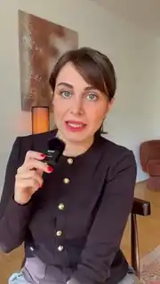
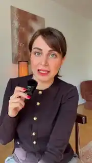
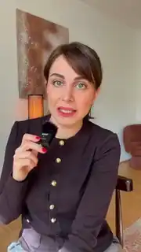
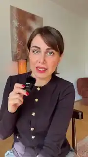
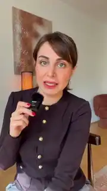
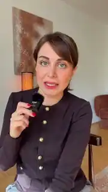

<div dir="rtl">

# جعبه‌ابزار ادیت ویدیو با هوش مصنوعی 🎬

راهنمای ساده و قدم‌به‌قدم برای اینکه افکت‌های حرفه‌ای (مثل `orbit`، `spotlight`، `glass-widgets`، `timeline` و ...) را با کمک **Claude Code** روی ویدیوهای خودتان بگذارید؛ بدون نیاز به بلد بودن برنامه‌نویسی.

🎬 **[کتابخانه‌ی ۴۵ افکت](#library):** برای هر افکت یک پیش‌نمایش روی ویدیوی خودم، توضیح فارسی و پرامپت آماده برای کپی.

> ⚠️ **مهم:** افکت‌ها و کدِ اصلی را **من نساخته‌ام**. آن‌ها کارِ [Vibha Ramprakash](https://github.com/Vibha-Ramprakash) هستند و در پروژه‌ی متن‌باز [claude-video-effects](https://github.com/Vibha-Ramprakash/claude-video-effects) منتشر شده‌اند. این مخزن فقط یک **راهنمای آموزشی فارسی** است و هیچ کدی از آن پروژه را در خودش ندارد. (جزئیات در بخش [قدردانی و مجوز](#credits))

---

<a id="toc"></a>

## فهرست

1. [این راهنما چه کاری می‌کند؟](#how)
2. [پیش‌نیازها](#prereq)
3. [نصب روی مک (macOS)](#mac)
4. [نصب روی ویندوز](#win)
5. [پرامپت‌های آماده برای Claude Code](#prompts)
6. [🎬 کتابخانه‌ی ۴۵ افکت (با پیش‌نمایش و پرامپت)](#library)
7. [خطاهای رایج و راه‌حل](#errors)
8. [قدردانی و مجوز](#credits)

---

<a id="how"></a>

## این راهنما چه کاری می‌کند؟

**Claude Code** دستیار هوش مصنوعی شرکت Anthropic است که می‌تواند روی کامپیوتر شما فایل بسازد، برنامه نصب کند و دستور اجرا کند. شما فقط به زبان ساده (انگلیسی) می‌گویید چه می‌خواهید.

پروژه‌ی **claude-video-effects** یک «مهارت» (Skill) برای Claude Code است. وقتی نصبش کنید، کافی است ویدیوی خودتان را به Claude بدهید و بنویسید مثلاً `/effects orbit from 3 to 6 seconds`. Claude صورت شما را در ویدیو پیدا می‌کند، افکت را طوری می‌گذارد که روی صورتتان نیفتد و یک فایل جدید کنار ویدیوی اصلی می‌سازد. صدای ویدیو دست نمی‌خورد.

خلاصه‌ی مسیر:

1. ابزارها را نصب می‌کنید (یک بار برای همیشه).
2. مهارت افکت‌ها را نصب می‌کنید (یک بار).
3. ویدیو را می‌دهید و افکت را می‌خواهید.
4. خروجی مخصوص اینستاگرام می‌گیرید.

---

<a id="prereq"></a>

## پیش‌نیازها

این‌ها را از روی فایل‌های خودِ پروژه‌ی اصلی (`README`، `requirements.txt` و `scripts/setup.sh`) استخراج کرده‌ام:

| ابزار | به چه دردی می‌خورد؟ | لازم است؟ |
|---|---|---|
| **Claude Code** | دستیاری که همه‌ی کارها را برایتان انجام می‌دهد. به اشتراک پولی Claude (مثل Pro یا Max) نیاز دارد. | ✅ بله |
| **Git** | برای دانلود (clone) پروژه از گیت‌هاب. روی ویندوز، Claude Code خودش هم به Git نیاز دارد. | ✅ بله |
| **Python نسخه‌ی ۳٫۱۰ یا جدیدتر** | زبانی که افکت‌ها با آن نوشته شده‌اند (نسخه‌ی ۳٫۱۲ پیشنهاد می‌شود). | ✅ بله |
| **FFmpeg** (همراه با `ffprobe`) | موتور اصلی خواندن و ساختن فایل ویدیو. | ✅ بله |
| کتابخانه‌های پایتون: `numpy`، `opencv-python`، `pillow`، `mediapipe` | تشخیص صورت، جدا کردن آدم از پس‌زمینه و طراحی افکت‌ها. **خودکار نصب می‌شوند.** | ✅ (خودکار) |
| `faster-whisper` | برای پیدا کردن زمان دقیق هر کلمه، وقتی می‌گویید «وقتی گفتم ...». بار اول خودکار نصب می‌شود. | اختیاری (خودکار) |
| **Homebrew** (فقط مک) / **winget** (فقط ویندوز) | «فروشگاه» نصب برنامه از طریق ترمینال. winget معمولاً روی ویندوز ۱۰ و ۱۱ از قبل هست. | پیشنهادی |
| **حساب GitHub** | برای دانلود لازم نیست؛ فقط اگر بخواهید پروژه را ستاره بزنید یا نسخه‌ی خودتان را منتشر کنید. | اختیاری |

> 💡 لازم نیست همه‌ی این‌ها را دستی نصب کنید. در بخش پرامپت‌ها، یک پرامپت آماده هست که از Claude می‌خواهد خودش بررسی و نصب کند.

---

<a id="mac"></a>

## نصب روی مک (macOS)

### قدم ۱: باز کردن ترمینال
کلید `⌘ Command` + `Space` را بزنید، بنویسید `Terminal` و Enter بزنید.

### قدم ۲: نصب Claude Code
این خط را در ترمینال کپی کنید و Enter بزنید:

<div dir="ltr">

```bash
curl -fsSL https://claude.ai/install.sh | bash
```

</div>

بعد بنویسید `claude` و Enter بزنید. بار اول از شما می‌خواهد وارد حساب Claude شوید. (اگر ترجیح می‌دهید، نسخه‌ی دسکتاپ Claude را از [claude.ai/download](https://claude.ai/download) بگیرید و از تب **Code** استفاده کنید.)

### قدم ۳: نصب Homebrew، Git، Python و FFmpeg
اگر Homebrew ندارید، دستور نصبش را از [brew.sh](https://brew.sh) کپی کنید. بعد:

<div dir="ltr">

```bash
brew install git python@3.12 ffmpeg
```

</div>

> یا ساده‌تر: داخل Claude Code **پرامپت شماره‌ی ۱** را بفرستید تا خودش انجام دهد.

### قدم ۴: نصب مهارت افکت‌ها

<div dir="ltr">

```bash
git clone https://github.com/Vibha-Ramprakash/claude-video-effects ~/.claude/skills/effects
```

</div>

### قدم ۵: Claude Code را ببندید و دوباره باز کنید
حالا `/effects` آماده است. بار اول که از آن استفاده کنید، Claude حدود ۱ تا ۳ دقیقه وقت می‌گذارد تا کتابخانه‌ها را نصب کند.

---

<a id="win"></a>

## نصب روی ویندوز

### قدم ۱: باز کردن PowerShell
روی دکمه‌ی Start کلیک کنید، بنویسید `PowerShell` و بازش کنید.

### قدم ۲: نصب Git
Claude Code روی ویندوز به **Git for Windows** نیاز دارد (Git Bash هم همراهش نصب می‌شود که اسکریپت نصب افکت‌ها به آن احتیاج دارد):

<div dir="ltr">

```powershell
winget install --id Git.Git -e
```

</div>

بعد از نصب، PowerShell را ببندید و دوباره باز کنید.

### قدم ۳: نصب Claude Code

<div dir="ltr">

```powershell
irm https://claude.ai/install.ps1 | iex
```

</div>

بعد بنویسید `claude` و وارد حسابتان شوید. (نسخه‌ی دسکتاپ هم از [claude.ai/download](https://claude.ai/download) در دسترس است.)

### قدم ۴: نصب Python و FFmpeg

<div dir="ltr">

```powershell
winget install Python.Python.3.12
winget install ffmpeg
```

</div>

دوباره PowerShell را ببندید و باز کنید تا ابزارهای جدید شناخته شوند.

### قدم ۵: نصب مهارت افکت‌ها

<div dir="ltr">

```powershell
git clone https://github.com/Vibha-Ramprakash/claude-video-effects $HOME\.claude\skills\effects
```

</div>

### قدم ۶: Claude Code را ببندید و دوباره باز کنید
تمام! حالا `/effects` کار می‌کند.

---

<a id="prompts"></a>

## پرامپت‌های آماده برای Claude Code

پرامپت‌ها عمداً **انگلیسی** هستند تا Claude دقیق‌ترین نتیجه را بدهد. فقط کپی کنید و داخل Claude Code بفرستید. هرجا `[...]` دیدید، با اطلاعات خودتان عوض کنید.

### ۱) نصب ابزارها

<div dir="ltr">

```text
I'm a beginner with no programming experience. Please check whether these are installed on my computer: Git, Python 3.10 or newer, FFmpeg and ffprobe. Install anything that is missing (on macOS use Homebrew, on Windows use winget). Explain each step in one simple sentence, and ask me before running anything that needs my password or admin rights. When you're done, show me the installed version of each tool.
```

</div>

### ۲) نصب و راه‌اندازی افکت‌ها

<div dir="ltr">

```text
Install the video effects skill from https://github.com/Vibha-Ramprakash/claude-video-effects into ~/.claude/skills/effects (on Windows use $HOME\.claude\skills\effects). If the folder already exists, update it with git pull instead of deleting it. Then run its scripts/setup.sh once and wait until it prints READY. If it prints NEED_FFMPEG or NEED_PYTHON, install what's missing and run it again. Finally, tell me if I need to restart Claude Code.
```

</div>

### ۳) گذاشتن افکت روی ویدیوی خودتان

اول ویدیو را داخل پنجره‌ی Claude بکشید (Drag & Drop). بعد یکی از این‌ها:

<div dir="ltr">

```text
/effects orbit from 3 to 6 seconds
```

```text
/effects spotlight when I say "[a word from your video]", with the word [YOUR WORD] glowing behind me
```

```text
Use the effects skill on my video [drag your video here]. Add "glass-widgets" for the first 3 seconds, then "backdrop-word" with the text "[YOUR WORD]" when I say "[a word from your video]". Before rendering, show me check frames and make sure nothing covers my face. Keep my original audio and save the result as a new file next to my video. Don't overwrite my original.
```

</div>

> 🎯 هر ۴۵ افکت با پیش‌نمایش و پرامپت آماده در [کتابخانه‌ی افکت‌ها](#library) است.

### ۴) خروجی آماده برای اینستاگرام (۱۰۸۰×۱۹۲۰)

<div dir="ltr">

```text
Take my rendered video [file name]_effects.mp4 and export an Instagram Reels version with FFmpeg:
- 1080x1920 (9:16). Scale to fit and crop if needed, never stretch.
- H.264 (libx264, High profile), pixel format yuv420p, 30 fps
- Video bitrate about 10 Mbps (maxrate 12M, bufsize 20M)
- AAC audio, 128 kbps, 48 kHz (keep the original audio)
- Add +faststart
Save it as [file name]_instagram.mp4 next to the original and don't overwrite any file. Then run ffprobe and show me the resolution, codec, fps and bitrate to confirm.
```

</div>

برای کسانی که می‌خواهند خودشان دستور را اجرا کنند، این همان کار را انجام می‌دهد:

<div dir="ltr">

```bash
ffmpeg -i input_effects.mp4 -vf "scale=1080:1920:force_original_aspect_ratio=increase,crop=1080:1920,fps=30" -c:v libx264 -profile:v high -pix_fmt yuv420p -b:v 10M -maxrate 12M -bufsize 20M -c:a aac -b:a 128k -ar 48000 -movflags +faststart output_instagram.mp4
```

</div>

### ۵) رفع خطا

<div dir="ltr">

```text
I got this error while using the effects skill:

[paste the full error here]

Explain in simple words what it means, find the cause, fix it, and tell me exactly what you changed. Don't delete or overwrite my videos.
```

```text
The effect doesn't look right: [describe what you see, e.g. "the word covers my face" or "it's too fast"]. Please show me check frames, adjust the plan, and render again as a new file.
```

</div>

---

<a id="library"></a>

## کتابخانه‌ی ۴۵ افکت 🎬

همه‌ی پیش‌نمایش‌های این بخش را خودم با اجرای کد اصلی افکت‌ها روی ویدیوی خودم ساخته‌ام. زیر هر افکت یک پرامپت آماده هست: روی آیکون کپی گوشه‌ی کادر بزنید، داخل Claude Code بفرستید و جای `[...]` را با متن خودتان عوض کنید. زمان‌ها (ثانیه) را هم می‌توانید تغییر دهید یا بنویسید «وقتی گفتم ...».

برای افکت‌هایی که ریلزهای شما را نشان می‌دهند، می‌توانید آدرس یک پوشه از اسکرین‌شات‌های ریلزهایتان را بدهید.

**پرش سریع:**

- 🎥 **[دوربین و زوم](#cat-camera)** (۶): [`locked-on`](#fx-locked-on)، [`lean-in`](#fx-lean-in)، [`pause-point`](#fx-pause-point)، [`rabbit-hole`](#fx-rabbit-hole)، [`slow-push`](#fx-slow-push)، [`over-the-shoulder-zoom`](#fx-over-the-shoulder-zoom)
- 💡 **[نور و رنگ](#cat-light)** (۴): [`spotlight`](#fx-spotlight)، [`moody`](#fx-moody)، [`swipe`](#fx-swipe)، [`dot-reveal`](#fx-dot-reveal)
- 🔤 **[متن و تیتر](#cat-text)** (۱۱): [`backdrop-word`](#fx-backdrop-word)، [`reject-stamp`](#fx-reject-stamp)، [`cover-star`](#fx-cover-star)، [`scribble`](#fx-scribble)، [`red-collage`](#fx-red-collage)، [`split-headline`](#fx-split-headline)، [`pastel-word`](#fx-pastel-word)، [`headline-box`](#fx-headline-box)، [`headline-wall`](#fx-headline-wall)، [`match-cut`](#fx-match-cut)، [`led-sign`](#fx-led-sign)
- 🧩 **[ویجت و رابط کاربری](#cat-ui)** (۱۴): [`the-bill`](#fx-the-bill)، [`todo`](#fx-todo)، [`comment-box`](#fx-comment-box)، [`tap`](#fx-tap)، [`uninstall`](#fx-uninstall)، [`shortcut-rain`](#fx-shortcut-rain)، [`countdown-flip`](#fx-countdown-flip)، [`glass-widgets`](#fx-glass-widgets)، [`timeline`](#fx-timeline)، [`tier-list`](#fx-tier-list)، [`checklist`](#fx-checklist)، [`liquid-glass-graph`](#fx-liquid-glass-graph)، [`apple-toggles`](#fx-apple-toggles)، [`messages`](#fx-messages)
- 📱 **[ریلز و پروفایل](#cat-reels)** (۱۰): [`noise`](#fx-noise)، [`lineup`](#fx-lineup)، [`orbit`](#fx-orbit)، [`reel-frame`](#fx-reel-frame)، [`check-pills`](#fx-check-pills)، [`profile-wall`](#fx-profile-wall)، [`broll-split`](#fx-broll-split)، [`phone-fan`](#fx-phone-fan)، [`carousel-spin`](#fx-carousel-spin)، [`place-in-grid`](#fx-place-in-grid)
- ✨ **[نسخه‌های ویژه](#cat-looks)** (۳)

<a id="cat-camera"></a>

### 🎥 دوربین و زوم

<a id="fx-locked-on"></a>

#### ۳. `locked-on`


براکت‌های گوشه روی صورتتان قفل می‌شوند و دوربین هر جا بروید دنبالتان می‌کند.

<div dir="ltr">

```text
/effects locked-on from 3 to 6 seconds, zoom 1.35, with the tag "[SHORT TAG]"
```

</div>

<a id="fx-lean-in"></a>

#### ۵. `lean-in`


یک زوم سریع و ضربه‌ای دقیقاً روی یک کلمه؛ برای تأکید روی جمله‌ی مهم.

<div dir="ltr">

```text
/effects lean-in when I say "[A WORD FROM YOUR VIDEO]", zoom 1.45
```

</div>

<a id="fx-pause-point"></a>

#### ۱۴. `pause-point`



تصویر فریز می‌شود و یک فلش دست‌کشیده با برچسب به شما اشاره می‌کند.

<div dir="ltr">

```text
/effects pause-point from 3 to 5 seconds, with the label "[LABEL]"
```

</div>

<a id="fx-rabbit-hole"></a>

#### ۲۰. `rabbit-hole`



تصویر چرخ‌زنان در خودش فرو می‌رود؛ مثل یک تونل بی‌انتها.

<div dir="ltr">

```text
/effects rabbit-hole from 4 to 6 seconds
```

</div>

<a id="fx-slow-push"></a>

#### ۴۲. `slow-push`


یک زوم آرام و سینمایی به صورت شما، در حالی که پس‌زمینه کم‌کم محو می‌شود.

<div dir="ltr">

```text
/effects slow-push from 0 to 5 seconds, zoom 1.6
```

</div>

<a id="fx-over-the-shoulder-zoom"></a>

#### ۴۳. `over-the-shoulder-zoom`


دوربین به یک گوشه می‌رود و نمودار شیشه‌ای کنار سرتان ظاهر می‌شود؛ بعد گوشه‌ی دیگر با نمودار دوم.

<div dir="ltr">

```text
/effects over-the-shoulder-zoom from 3 to 9 seconds, labels "[LABEL 1]|[LABEL 2]", numbers "[NUMBER 1]|[NUMBER 2]"
```

</div>

<a id="cat-light"></a>

### 💡 نور و رنگ

<a id="fx-spotlight"></a>

#### ۷. `spotlight`


چراغ‌های اتاق خاموش می‌شوند و فقط شما زیر نور می‌مانید، با یک کلمه‌ی درخشان پشت سر.

<div dir="ltr">

```text
/effects spotlight when I say "[A WORD FROM YOUR VIDEO]", with the word "[YOUR WORD]" glowing behind me
```

</div>

<a id="fx-moody"></a>

#### ۹. `moody`


یک رنگ‌بندی سینمایی و احساسی. حالت‌های دیگر: سیاه‌سفید، گرم، سرد و پرانرژی.

<div dir="ltr">

```text
/effects moody from 0 to 5 seconds, grade moody (other options: bw, warm, cool, pop)
```

</div>

<a id="fx-swipe"></a>

#### ۱۰. `swipe`


یک اسلایدر «قبل و بعد» از روی تصویر رد می‌شود و رنگ‌بندی جدید را نشان می‌دهد.

<div dir="ltr">

```text
/effects swipe from 2 to 4 seconds, with grade bw as the "after" look
```

</div>

<a id="fx-dot-reveal"></a>

#### ۳۴. `dot-reveal`


تصویر شما از نقطه‌های درخشان ساخته می‌شود و بعد ناگهان واضح می‌شود. برای شروع ویدیو عالی است.

<div dir="ltr">

```text
/effects dot-reveal from 0 to 2 seconds
```

</div>

<a id="cat-text"></a>

### 🔤 متن و تیتر

<a id="fx-backdrop-word"></a>

#### ۶. `backdrop-word`


یک کلمه‌ی غول‌پیکر از بالا فرود می‌آید و پشت سرتان می‌نشیند.

<div dir="ltr">

```text
/effects backdrop-word from 2 to 4 seconds, with the word "[YOUR WORD]" in the serif font
```

</div>

<a id="fx-reject-stamp"></a>

#### ۱۸. `reject-stamp`


یک مُهر قرمز بزرگ با ضرب روی صفحه می‌خورد؛ برای «نه» گفتن به یک ایده.

<div dir="ltr">

```text
/effects reject-stamp when I say "[A WORD FROM YOUR VIDEO]", stamping "NOPE"
```

</div>

<a id="fx-cover-star"></a>

#### ۲۱. `cover-star`


شما روی جلد یک مجله می‌روید و اسم مجله پشت سرتان است.

<div dir="ltr">

```text
/effects cover-star from 2 to 5 seconds, magazine title "[TITLE]", cover lines "[LINE 1]|[LINE 2]"
```

</div>

<a id="fx-scribble"></a>

#### ۲۲. `scribble`



خط‌خطی‌های ماژیکی خودشان دور شما کشیده می‌شوند.

<div dir="ltr">

```text
/effects scribble from 3 to 5 seconds, with the label "[SHORT LABEL]"
```

</div>

<a id="fx-red-collage"></a>

#### ۲۴. `red-collage`


شما سیاه‌وسفید می‌شوید، یک کلمه‌ی قرمز بزرگ پشت سر و سه خط متن با ضرب وارد می‌شوند.

<div dir="ltr">

```text
/effects red-collage from 0 to 3 seconds, red word "[WORD]", lines "[LINE 1]|[LINE 2]|[LINE 3]"
```

</div>

<a id="fx-split-headline"></a>

#### ۲۵. `split-headline`


کارت تیتر از بالا پایین می‌آید و شما را به نیمه‌ی پایین کادر هل می‌دهد.

<div dir="ltr">

```text
/effects split-headline from 0 to 4 seconds, headline "[LINE 1]|[LINE 2]", highlight the word "[WORD]"
```

</div>

<a id="fx-pastel-word"></a>

#### ۲۶. `pastel-word`


اتاق یاسی می‌شود، یک کلمه‌ی بزرگ پشت سرتان می‌آید و یک کارت پروفایل فالو می‌شود.

<div dir="ltr">

```text
/effects pastel-word from 2 to 5 seconds, word "[WORD]", name "[YOUR NAME]", handle "@[YOUR HANDLE]"
```

</div>

<a id="fx-headline-box"></a>

#### ۲۹. `headline-box`


یک زوم ضربه‌ای با تیتر دوخطی تمیز؛ خط دوم داخل یک کادر سفید.

<div dir="ltr">

```text
/effects headline-box from 1 to 4 seconds, headline "[LINE 1]|[LINE 2]"
```

</div>

<a id="fx-headline-wall"></a>

#### ۳۵. `headline-wall`



تیترهای خودتان پشت سرتان روی هم جمع می‌شوند و در آخر یک عدد کل جلوی شما ظاهر می‌شود.

<div dir="ltr">

```text
/effects headline-wall from 3 to 7 seconds, headlines "[HEADLINE 1]::[VIEWS]|[HEADLINE 2]::[VIEWS]|[HEADLINE 3]::[VIEWS]", total "[YOUR REAL TOTAL]". The handle @vibha.in.progress is hard-coded on the cards in fx.py, so show my handle "@[YOUR HANDLE]" there instead
```

</div>

<a id="fx-match-cut"></a>

#### ۳۹. `match-cut`


صفحه‌های خبر روی یک کلمه کات می‌خورند و آن کلمه در کادر قرمز پشت سرتان ثابت می‌ماند.

<div dir="ltr">

```text
/effects match-cut from 1 to 3 seconds, on the word "[WORD]"
```

</div>

<a id="fx-led-sign"></a>

#### ۴۱. `led-sign`


نور اتاق کم می‌شود و یک تابلوی LED درخشان پشت سرتان خودش تایپ می‌شود.

<div dir="ltr">

```text
/effects led-sign from 2 to 5 seconds, sign text "[LINE 1]|[LINE 2]"
```

</div>

<a id="cat-ui"></a>

### 🧩 ویجت و رابط کاربری

<a id="fx-the-bill"></a>

#### ۸. `the-bill`


دستورهای شما مثل فیش خرید، از دیوار بالای سرتان چاپ می‌شود.

<div dir="ltr">

```text
/effects the-bill from 4 to 8 seconds, printing the lines "[LINE 1]|[LINE 2]|[LINE 3]"
```

</div>

<a id="fx-todo"></a>

#### ۱۱. `todo`


یک کارت چک‌لیست کنار سرتان؛ هر مورد هم‌زمان با حرف زدنتان تیک می‌خورد.

<div dir="ltr">

```text
/effects todo from 2 to 8 seconds, title "[TITLE]", items "[ITEM 1]|[ITEM 2]|[ITEM 3]", tick each item when I say it
```

</div>

<a id="fx-comment-box"></a>

#### ۱۲. `comment-box`


یک کامنت اینستاگرام خودش تایپ می‌شود و ارسال می‌شود.

<div dir="ltr">

```text
/effects comment-box at the end, typing "[YOUR WORD]", with my handle "[YOUR HANDLE]"
```

</div>

<a id="fx-tap"></a>

#### ۱۳. `tap`


دکمه‌ی Follow ظاهر می‌شود و با یک کلیک به Following تبدیل می‌شود.

<div dir="ltr">

```text
/effects tap from 5 to 7 seconds, flipping to Following when I say "[A WORD FROM YOUR VIDEO]"
```

</div>

<a id="fx-uninstall"></a>

#### ۱۵. `uninstall`


یک نوار «حذف برنامه» با جلوه‌ی گلیچ، کادر تصویر را تکه‌تکه می‌کند.

<div dir="ltr">

```text
/effects uninstall from 2 to 4 seconds, uninstalling "[APP NAME]"
```

</div>

<a id="fx-shortcut-rain"></a>

#### ۱۷. `shortcut-rain`


کلیدهای کیبورد پشت سرتان مثل باران می‌بارند.

<div dir="ltr">

```text
/effects shortcut-rain from 1 to 4 seconds, with the keys "⌘|Z|K|J"
```

</div>

<a id="fx-countdown-flip"></a>

#### ۱۹. `countdown-flip`


یک ساعت ورق‌خور بالای سرتان ۳، ۲، ۱ را می‌شمارد.

<div dir="ltr">

```text
/effects countdown-flip from 0 to 3 seconds, counting down from 3
```

</div>

<a id="fx-glass-widgets"></a>

#### ۲۳. `glass-widgets`


ویجت‌های شیشه‌ای مات دور سرتان شناورند، همراه برچسب «Edited by Claude».

<div dir="ltr">

```text
/effects glass-widgets for the first 3 seconds, big number "[YOUR NUMBER]", name "[YOUR NAME]", handle "@[YOUR HANDLE]"
```

</div>

<a id="fx-timeline"></a>

#### ۲۸. `timeline`


رنگ‌بندی فیلمی قرمز تیره با تایم‌لاین ادیت، تایم‌کد REC و یک خط پخش درخشان.

<div dir="ltr">

```text
/effects timeline from 0 to 4 seconds
```

</div>

<a id="fx-tier-list"></a>

#### ۳۱. `tier-list`


یک جدول رتبه‌بندی پایین می‌آید و Claude مستقیم به ردیف S پرواز می‌کند.

<div dir="ltr">

```text
/effects tier-list from 4 to 7 seconds, title "[QUESTION]", with "Claude" flying into S tier
```

</div>

<a id="fx-checklist"></a>

#### ۳۶. `checklist`


لیست کارهای Claude زیر چانه‌تان؛ هر مرحله می‌چرخد و سبز تیک می‌خورد.

<div dir="ltr">

```text
/effects checklist from 2 to 7 seconds, title "[TITLE]", steps "[STEP 1]::[NOTE]|[STEP 2]::[NOTE]|[STEP 3]::[NOTE]"
```

</div>

<a id="fx-liquid-glass-graph"></a>

#### ۳۷. `liquid-glass-graph`



یک کارت «شیشه‌ی مایع» زیر چانه؛ نمودار سبز بالا می‌رود و عدد هم‌زمان می‌شمارد.

<div dir="ltr">

```text
/effects liquid-glass-graph from 3 to 6 seconds, label "[LABEL]", counting from 0 to "[YOUR REAL NUMBER, e.g. 197K]"
```

</div>

<a id="fx-apple-toggles"></a>

#### ۴۰. `apple-toggles`


سوییچ‌های تنظیمات آیفون یکی‌یکی و هم‌زمان با حرفتان روشن می‌شوند.

<div dir="ltr">

```text
/effects apple-toggles from 2 to 6 seconds, rows "[ROW 1]|[ROW 2]|[ROW 3]", flip each switch when I say it
```

</div>

<a id="fx-messages"></a>

#### ۴۴. `messages`


نوتیفیکیشن‌های iMessage یکی پس از دیگری با یک درخشش ملایم روی هم می‌آیند.

<div dir="ltr">

```text
/effects messages from 2 to 6 seconds, messages "[MESSAGE 1]|[MESSAGE 2]|[MESSAGE 3]"
```

</div>

<a id="cat-reels"></a>

### 📱 ریلز و پروفایل

<a id="fx-noise"></a>

#### ۱. `noise`


ریلزهای شما یکی‌یکی و پشت‌سرهم، پشت سرتان روی هم تلنبار می‌شوند.

<div dir="ltr">

```text
/effects noise from 1 to 4 seconds, using the screenshots in [PATH TO YOUR REELS FOLDER]
```

</div>

<a id="fx-lineup"></a>

#### ۲. `lineup`


کاشی‌های شماره‌دار مثل یک کمان بالای سرتان باز می‌شوند. برای معرفی چند مرحله یا چند ابزار عالی است.

<div dir="ltr">

```text
/effects lineup from 2 to 5 seconds, with tiles "[ITEM 1]|[ITEM 2]|[ITEM 3]|[ITEM 4]"
```

</div>

<a id="fx-orbit"></a>

#### ۴. `orbit`


ریلزهایتان دور سرتان می‌چرخند: پایین از جلوی شما رد می‌شوند و بالا از پشت سرتان.

<div dir="ltr">

```text
/effects orbit from 3 to 6 seconds, using the screenshots in [PATH TO YOUR REELS FOLDER]
```

</div>

<a id="fx-reel-frame"></a>

#### ۱۶. `reel-frame`


ویدیوی شما کوچک می‌شود و داخل قاب یک کارت ریلز اینستاگرام قرار می‌گیرد.

<div dir="ltr">

```text
/effects reel-frame from 6 to 9 seconds, with my handle "@[YOUR HANDLE]"
```

</div>

<a id="fx-check-pills"></a>

#### ۲۷. `check-pills`


اتاق کاغذ شطرنجی می‌شود، ریلزهایتان پشت سر سنجاق می‌شوند و نشانگر روی دکمه‌های آبی کلیک می‌کند.

<div dir="ltr">

```text
/effects check-pills from 3 to 6 seconds, pills "[PILL 1]|[PILL 2]|[PILL 3]", using the screenshots in [PATH TO YOUR REELS FOLDER], handle "@[YOUR HANDLE]"
```

</div>

<a id="fx-profile-wall"></a>

#### ۳۰. `profile-wall`


گرید ریلزهایتان دیوار پشت سر را پر می‌کند و یک شمارنده بالا می‌رود.

<div dir="ltr">

```text
/effects profile-wall from 3 to 6 seconds, using the screenshots in [PATH TO YOUR REELS FOLDER], name "[YOUR HANDLE]"
```

</div>

<a id="fx-broll-split"></a>

#### ۳۲. `broll-split`


بی‌رول در نیمه‌ی بالا با یک برچسب قیمت‌مانند، و شما در نیمه‌ی پایین.

<div dir="ltr">

```text
/effects broll-split from 2 to 5 seconds, b-roll from [PATH TO YOUR B-ROLL FOLDER], tag "[TAG TEXT]"
```

</div>

<a id="fx-phone-fan"></a>

#### ۳۳. `phone-fan`


ریلزهایتان مثل یک دسته گوشی زیر یک تیتر باز می‌شوند.

<div dir="ltr">

```text
/effects phone-fan from 2 to 5 seconds, headline "[LINE 1]|[LINE 2]", using the screenshots in [PATH TO YOUR REELS FOLDER]
```

</div>

<a id="fx-carousel-spin"></a>

#### ۳۸. `carousel-spin`


ریلزهایتان در یک چرخ‌وفلک سه‌بعدی دورتان می‌چرخند و آرام می‌ایستند.

<div dir="ltr">

```text
/effects carousel-spin from 2 to 6 seconds, using the screenshots in [PATH TO YOUR REELS FOLDER]
```

</div>

<a id="fx-place-in-grid"></a>

#### ۴۵. `place-in-grid`


شما وسط گرید ۳×۳ پروفایلتان کوچک می‌شوید و ریلزها با تعداد بازدید دورتان ظاهر می‌شوند.

<div dir="ltr">

```text
/effects place-in-grid from 4 to 7 seconds, using the reels in [PATH TO YOUR REELS FOLDER], views "[9 VIEW COUNTS, separated by |]"
```

</div>

<a id="cat-looks"></a>

### ✨ نسخه‌های ویژه

همان افکت‌ها با ظاهری خاص‌تر؛ جزو ۴۵ افکت حساب نمی‌شوند.

<a id="fx-glitter-spotlight"></a>

#### `glitter-spotlight`



نسخه‌ی طلایی spotlight: پرتوهای طلایی از پشت سر، کلمه‌ی طلایی براق و ستاره‌های چشمک‌زن.

<div dir="ltr">

```text
/effects glitter-spotlight when I say "[A WORD FROM YOUR VIDEO]", with the word "[YOUR WORD]"
```

</div>

<a id="fx-cover-star--editorial"></a>

#### `cover-star look=editorial`


جلد مجله‌ی کلاسیک با رنگ فیلمی گرم و تیتر سریف شیک.

<div dir="ltr">

```text
/effects cover-star look=editorial from 2 to 5 seconds, masthead "[TITLE]", issue "[ISSUE LINE]", lines "[LINE 1]|[LINE 2]|[LINE 3]"
```

</div>

<a id="fx-liquid-glass-graph--bento"></a>

#### `liquid-glass-graph look=bento`


نمودار روی صفحه‌ی شیشه‌ای دودی پشت سر، با کاشی‌های بنتو (دونات، KPI و میله‌ها) جلوی شما.

<div dir="ltr">

```text
/effects liquid-glass-graph look=bento from 3 to 7 seconds, label "[LABEL]", counting to "[YOUR REAL NUMBER]"
```

</div>

[⬆ بازگشت به فهرست](#toc)

---

<a id="errors"></a>

## خطاهای رایج و راه‌حل

| مشکل | دلیل احتمالی | راه‌حل |
|---|---|---|
| `command not found: ffmpeg` یا `NEED_FFMPEG` | FFmpeg نصب نیست یا ترمینال هنوز آن را نمی‌شناسد. | مک: `brew install ffmpeg` / ویندوز: `winget install ffmpeg`. بعد ترمینال را ببندید و باز کنید. |
| `NEED_PYTHON` | پایتون نیست یا نسخه‌اش قدیمی‌تر از ۳٫۱۰ است. | مک: `brew install python@3.12` / ویندوز: `winget install Python.Python.3.12` |
| Claude دستور `/effects` را نمی‌شناسد | مهارت در پوشه‌ی درست نیست یا Claude Code ری‌استارت نشده. | مطمئن شوید پوشه دقیقاً `~/.claude/skills/effects` است و فایل `SKILL.md` داخلش هست. بعد Claude Code را ببندید و باز کنید. |
| `brew: command not found` (مک) | Homebrew نصب نیست. | از [brew.sh](https://brew.sh) نصبش کنید. |
| `winget` شناخته نمی‌شود (ویندوز) | App Installer قدیمی است. | App Installer را از Microsoft Store به‌روز کنید. |
| `bash` روی ویندوز پیدا نمی‌شود | Git for Windows نصب نیست. | `winget install --id Git.Git -e` |
| نوشته یا افکت روی صورت افتاده | زمان‌بندی یا متن خیلی بلند است. | پرامپت دوم بخش «رفع خطا» را بفرستید. |
| بار اول خیلی طول می‌کشد | نصب کتابخانه‌ها و مدل تشخیص کلمه. | طبیعی است؛ ۱ تا ۳ دقیقه صبر کنید (برای تشخیص کلمه کمی بیشتر). |

**نکته‌های طلایی:**
- ویدیوی عمودی که خودتان در کادر هستید بهترین نتیجه را می‌دهد.
- هر افکت را کوتاه نگه دارید (۱٫۵ تا ۴ ثانیه).
- این افکت‌ها «نسخه‌ی اولیه» هستند. همیشه قبل از پست کردن، خروجی را نگاه کنید.
- صدا و زیرنویس اضافه نمی‌شود؛ آن‌ها را در CapCut یا برنامه‌ی دلخواهتان اضافه کنید.

---

<a id="credits"></a>

## قدردانی و مجوز

### 💛 سازنده‌ی افکت‌ها: Vibha Ramprakash
- همه‌ی افکت‌ها، کد و ایده‌ی اصلی متعلق به **Vibha Ramprakash** است.
- مخزن اصلی: [github.com/Vibha-Ramprakash/claude-video-effects](https://github.com/Vibha-Ramprakash/claude-video-effects)
- اینستاگرام: [@vibha.in.progress](https://instagram.com/vibha.in.progress)
- **مجوز پروژه‌ی اصلی: MIT** (© 2026 Vibha Ramprakash). فونت‌ها و مدل‌های داخل آن پروژه مجوزهای خودشان را دارند: تشخیص صورت OpenCV YuNet (MIT)، MediaPipe Selfie Segmenter (Apache 2.0) و فونت‌ها (SIL OFL و Apache 2.0).
- این مخزن **هیچ کد، تصویر یا متنی** از پروژه‌ی اصلی را کپی نکرده است؛ فقط به آن لینک می‌دهد و روش دانلودش را آموزش می‌دهد. همه‌ی توضیحات فارسی این‌جا نوشته‌ی خود من است.
- پیش‌نمایش‌های این راهنما (`docs/previews/`) را با اجرای کد اصلی (`scripts/fx.py`) روی ویدیوهای خودم ساخته‌ام. تنها تغییر برای این رندرها: هندل `@vibha.in.progress` که در افکت `headline-wall` ثابت نوشته شده بود، با `@yekta_journal` جایگزین شد.
- این راهنما رسمی نیست و از طرف Vibha یا Anthropic تأیید نشده است.

### مجوز همین راهنما
- متن و محتوای آموزشی این مخزن تحت مجوز **[CC BY 4.0](https://creativecommons.org/licenses/by/4.0/)** منتشر شده است (فایل [`LICENSE`](LICENSE)): آزادید استفاده، ترجمه یا بازنشر کنید، فقط نام منبع را ذکر کنید.
- کدهای کوچک HTML/CSS/JS در پوشه‌ی `docs/` تحت مجوز **MIT** هستند (فایل [`LICENSE-CODE`](LICENSE-CODE)).
- ویدیوها و تصاویر پیش‌نمایش در `docs/previews/` تصویر خود من هستند: **© Yekta Ghafelehbashi، همه‌ی حقوق محفوظ است** و شامل مجوزهای بالا نمی‌شوند.

---

ساخته‌شده با ❤️ توسط **Yekta Ghafelehbashi** · اینستاگرام: [@yekta_journal](https://instagram.com/yekta_journal)

</div>
